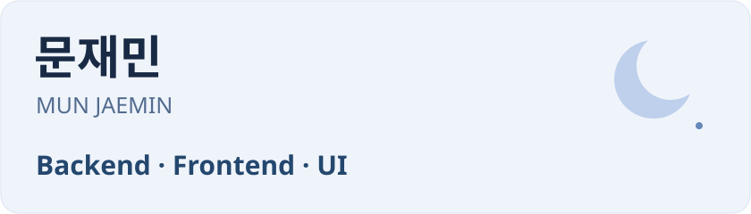
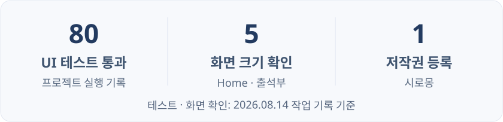

**Java·Spring 백엔드를 중심으로, 프론트엔드와 UI도 구현합니다.**

OMAGOTCHI에서 출결·보상 기능과 사용자 화면을 만들었습니다.
서버의 재시도·동시 요청과 화면의 로딩·빈 데이터·오류 상태를 다뤘습니다.

[NHN Academy AIoT 3기](https://github.com/nhnacademy-aiot3) · Java Backend 과정 수료 (2025.12–2026.09)

## OMAGOTCHI

출석과 학습 기록을 캐릭터 성장으로 연결한 **8인 팀 프로젝트**입니다.
기수·출결·게이미피케이션 백엔드와 Home·반응형 UI를 담당했습니다.

### Backend

**출결 기록과 보상 사이의 누락·중복 처리**

출결 저장 후 이벤트 발송이 실패할 수 있어, 출결과 Outbox 이벤트를 같은 트랜잭션에 기록하고 발송 실패를 재처리하도록 구현했습니다.
재수신·동시 요청은 수신 영수증, XP 원장, 행 잠금과 유니크 제약으로 중복 반영을 막도록 구성했습니다.

**시간에 따라 달라지는 출결 판정 검증**

출결 정책을 분리하고 Clock을 주입해 정시·지각·타임존 경계 조건을 테스트했습니다.

### Frontend

**작은 화면에서 겹치던 Home 개선**

고정 좌표로 배치하던 HUD를 문서 흐름과 Grid 기반으로 바꾸고, 단일 `/home`에서 반응형 레이아웃을 구현했습니다.

**조회 실패와 실제 0명 구분**

재실 조회 실패를 정상 값인 0명으로 표시하던 fallback을 제거했습니다.
`loading`, `empty`, `error`를 구분해 응답 상태에 맞게 보여주도록 수정했습니다.

[Frontend 저장소 →](https://github.com/nhnacademy-aiot3-omagotchi/omagotchi-frontend)

### 확인한 기록

수치의 기준과 검증 범위

**테스트·반응형은 2026.08.14 UI 통합 리팩토링 작업 기록 기준입니다.**

- Vitest **21개 파일·80개 테스트 통과**: 당시 프로젝트 실행 결과이며, 모든 테스트를 제가 작성했다는 의미는 아닙니다.
- **5개 화면 크기**: 1440×900, 1024×768, 844×390, 390×844, 320×568.
- 정적 통합 fixture에서 Home·출석부의 가로 넘침, 패널 열기·닫기, 포커스 복귀 등을 확인했습니다.
- 실제 서비스 전체의 E2E 완료나 사용자 대상 사용성 검증을 뜻하지 않습니다.
- **저작권 등록 1건**: 직접 제작한 시로몽 캐릭터·픽셀 아트·애니메이션. 제C-2026-040776호.

## 그 밖의 개발 경험

**Mini Dooray**

Project·Project Member·Tag·Milestone **4개 영역**의 서비스·Controller와 관련 테스트를 구현했습니다.
Front·Gateway 담당자와 API 계약을 맞춰 연동했습니다.

**Flip-Bot**

Python·discord.py 경제 시뮬레이션 봇을 개발했습니다.
사용자 자산·거래 기록을 관리하고 Railway 배포 오류를 로그로 확인했습니다.

## 사용한 기술

- **Backend** · Java, Spring Boot, Spring MVC, JPA, PostgreSQL
- **Frontend** · HTML, CSS, JavaScript, React, Thymeleaf
- **확인·협업** · JUnit 5, Vitest, Storybook, Git, GitHub
- **UI·시각 작업** · Figma, Aseprite

Figma로 화면을 설계하고 Aseprite로 캐릭터·픽셀 애니메이션을 제작했습니다.
시로몽의 저작권은 직접 제작한 시각 에셋에 관한 것이며, 팀 프로젝트 전체를 의미하지 않습니다.
에셋의 재사용·재배포는 사전 문의해 주세요.
